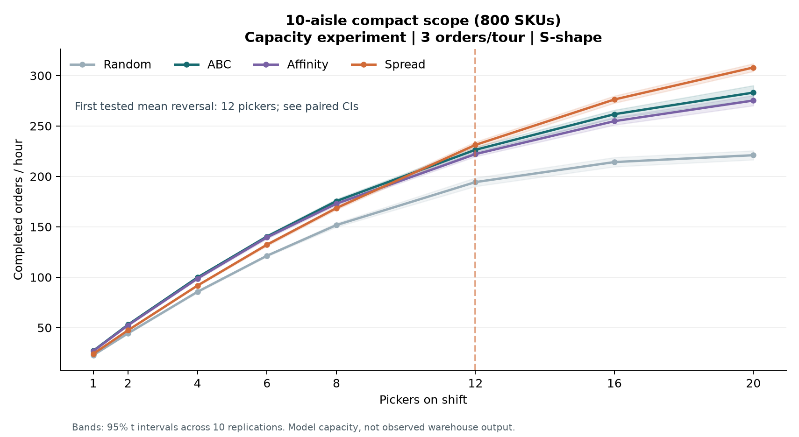

# Warehouse slotting and picker congestion

A simulation of how grocery shelf placement affects walking distance, order completion and paid labor.

Shawn Lee · [shawnslee1202](https://github.com/shawnslee1202)



With three orders per trip in the ten-aisle layout, spreading popular products across aisles first led on average at 12 pickers.

## What this is

Putting popular products near the packing station can shorten walks, but pickers may have to wait for someone else to leave an aisle. This study compared four ways to place products using 3.21 million prior grocery orders from Instacart. Product placement was set using training orders and evaluated on a separate sample of 60,000 orders. Across 2,900 simulated shifts, the study varied staffing, orders per trip and aisle traffic rules.

## Results at a glance

| Comparison | Finding |
|---|---|
| Walking alone | In the 115-aisle layout, grouping popular items near the front (ABC) cut single-order walking distance by 19.2% versus random placement. [Travel results](docs/RESULTS.md#out-of-sample-single-order-travel) |
| Three orders per trip | In ten aisles, spreading popular items first led at 12 pickers. The advantage held from 16 pickers after accounting for all eight staffing comparisons. [Paired comparisons](docs/RESULTS.md#paired-comparison-against-abc) |
| Five orders per trip | At 20 pickers in ten aisles, ABC completed 410.0 orders per hour versus 393.6 for spread placement. [Batching results](docs/RESULTS.md#why-the-crossover-is-conditional) |
| Larger floor | Spread placement never led through 20 pickers in 115 aisles. Its first lead in the extended staffing tests came at 138 pickers. [Staffing by aisle density](docs/RESULTS.md#larger-layout-density-extension) |
| Labor and order time | At an assumed 33.1 eligible orders per hour, six pickers using ABC and five-order trips used 183.2 paid hours per 1,000 orders. Compared with three-order ABC trips and eight pickers, labor fell 24.5% while the first order in each batch took 13.1 minutes longer on average. [Labor estimates](docs/RESULTS.md#demand-based-staffing-and-paid-labor) |

## Quick start

Read the [two-page report](report.pdf) or download and open the [offline dashboard](dashboard.html). To run the tests with Python 3.12, use PowerShell from the repository root.

```powershell
python -m venv .venv
.venv\Scripts\Activate.ps1
python -m pip install -r requirements.txt
python -m unittest discover -s tests -v
```

## Reproduce

To rebuild the report, dashboard and notebooks from the included tables, run `python -m warehouse_slotting.reporting.deliver --root .`.

For a full simulation, run the following commands in a fresh checkout after setup. Allow tens of minutes on a four-worker machine, plus download time, and about 2 GB of disk space. The [pinned public data mirror](https://huggingface.co/datasets/attik/Instacart-Market-Basket-Analysis/tree/ff7fd3515d570a606635dfc263cf65216af57713) requires no credentials.

```powershell
python -m warehouse_slotting.data.download --out data/raw
python -m warehouse_slotting.data.prepare --raw data/raw --out data/processed
python -m warehouse_slotting.validation.audit --root . --raw data/raw
python -m warehouse_slotting.experiment.run build --processed data/processed --cache cache --results results
python -m warehouse_slotting.experiment.run run --cache cache --results results --workers 4 --reps 10
python -m warehouse_slotting.experiment.supplement --cache cache --results results
python -m warehouse_slotting.analysis.analyze --root .
python -m warehouse_slotting.validation.audit --root .
python -m warehouse_slotting.reporting.deliver --root .
```

The simulation regenerates individual shift records and shelf assignments. The [original run files](https://github.com/shawnslee1202/warehouse-slotting/tree/0fecc92dc044f413ccf9aba906f88bc311b50518/results) are available for comparison.

## Repository map

| Location | Contents |
|---|---|
| `warehouse_slotting/data/` | Data download, training split and product selection |
| `warehouse_slotting/model/` | Shelf placement, routes and picker movement |
| `warehouse_slotting/experiment/` | Staffing, batching and traffic comparisons |
| `warehouse_slotting/analysis/` | Operating curves, confidence intervals and labor estimates |
| `warehouse_slotting/reporting/` | Report, dashboard and notebook generation |
| `warehouse_slotting/validation/`, `tests/` | Data checks, reference simulator and automated tests |
| `results/`, `figures/`, `notebooks/` | Result tables, charts and executed notebooks |
| `docs/` | [Methods](docs/METHODS.md), [findings](docs/RESULTS.md) and [reproduction notes](docs/REPRODUCE.md) |

## Limitations

- The compact layout could fill 8.0% of sampled orders in full, and the larger layout could fill 53.0%. [Order coverage](docs/RESULTS.md#coverage-and-selection-bias)
- The layout, walking speed, storage temperatures and rules for entering an aisle are assumptions. [Model assumptions](docs/METHODS.md)
- Entry control accounted for 76.6% of ABC waiting time at 20 pickers in the compact layout. [Waiting time breakdown](docs/RESULTS.md#blocking-decomposition)
- Demand and wages are illustrative, and the labor estimates exclude replenishment, breaks and orders with products outside the modeled range. [Cost assumptions](docs/METHODS.md)

## Sources and attribution

Data come from *The Instacart Online Grocery Shopping Dataset 2017*. The study draws on the order-picking review by [de Koster and colleagues](https://doi.org/10.1016/j.ejor.2006.07.009) and the narrow-aisle blocking study by [Gue and colleagues](https://doi.org/10.1080/07408170600809341). The dataset retains its original terms. The project code has no specified open-source license. [License notice](docs/LICENSE_NOTICE.md)
